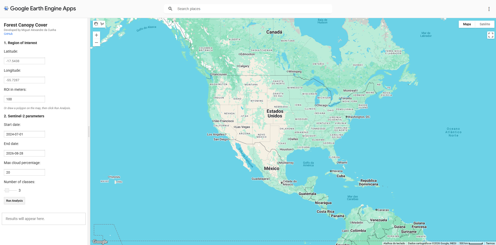

# Local Forest Watch

  
  
  

Aplicativo do Google Earth Engine que estima a cobertura florestal e a altura do dossel em uma área de interesse, combinando imagens **Sentinel-2** com o mapa de altura do dossel da **Meta (1 m)**.

**[Abrir o aplicativo](https://programa-r-316514.projects.earthengine.app/view/forest-canopy)**

  

## Como funciona

1. Gera um mosaico Sentinel-2 (mediana) para o período e o limite de nuvens escolhidos.
2. Calcula o NDVI e o classifica por quebras naturais de Jenks; a classe mais alta é considerada floresta.
3. Calcula o percentual de floresta e a altura média e máxima do dossel dentro dessa área.

## Como usar

1. Defina a área: latitude, longitude e tamanho em metros, ou desenhe um polígono no mapa.
2. Escolha o período (`YYYY-MM-dd`), o percentual máximo de nuvens e o número de classes.
3. Clique em **Run Analysis**.

Para rodar no [Code Editor](https://code.earthengine.google.com/), cole o conteúdo de [`forest-canopy.js`](forest-canopy.js) em um script novo e clique em **Run**.

## Dados

- Sentinel-2 SR Harmonized: `COPERNICUS/S2_SR_HARMONIZED`
- Meta Global Canopy Height: `projects/meta-forest-monitoring-okw37/assets/CanopyHeight` ([Tolan et al., 2024](https://doi.org/10.1016/j.rse.2023.113888))

## Licença

Distribuído sob a licença [GNU GPL v3.0](LICENSE).
